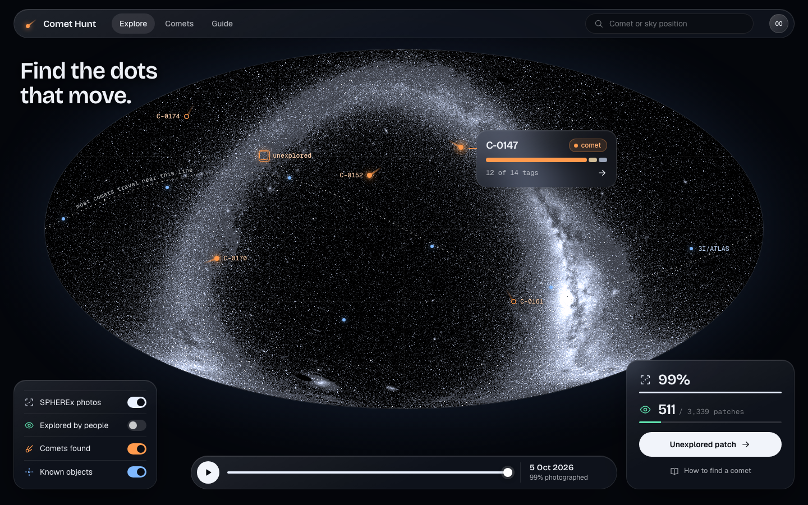

# Comet Hunt



A public web tool for NASA Space Apps 2026 ("Planet X and SPHEREx"). People explore the sky in real SPHEREx infrared images, spot dots that move between photos, tag them as comets, asteroids or glitches, and discuss each one. Working name.

## Run it

Needs Node 20 or newer.

```bash
npm install
```

```bash
npm run dev
```

Then open http://localhost:8787. One Cloudflare Worker serves both the app (`web/`) and the API (`/api/*`), the same way it will run once deployed. No Cloudflare account is needed to run it locally.

Try it: drag the time slider to watch SPHEREx photograph the sky, turn on "Explored by people", then click anywhere on the map to open a live time-lapse of that patch.

## What is in here

| Folder | What it holds |
|---|---|
| `web/` | The app. Plain HTML and JavaScript, no build step. `index.html` + `explore.js` is the sky map; `timelapse.html` opens a patch; `comet.html` and `guide.html` are designs not yet wired up. |
| `worker/` | The Cloudflare Worker: the API (`docs/api.md`) and the static file server. |
| `bake/` | Python scripts that prepare data: the coverage map, the all-sky picture, pre-built time-lapses for five test targets, and the science checks. |
| `design/` | The screen designs (`design/screens/`), earlier mockups and their briefs. |
| `docs/` | `team.md` (who builds what, how to contribute), `api.md`, `architecture.html`, `prior-art.md`. |

## Checks

- `python3 bake/verify.py`: measured star motions against Gaia and published values.
- http://localhost:8787/tests/golden.html: browser astronomy math against astropy.
- http://localhost:8787/tests/live.html: live search against the pre-built targets.
- `npm test` (with `npm run dev` running): the API's requests, refusals and pages.

## Rebuilding data

Downloaded photo cutouts (`bake/cache/`) and the raw coverage list (`bake/coverage/`) are not in git. `bake/coverage.py` rebuilds the coverage list in about 90 minutes; `bake/sky_assets.py` turns it into `web/data/coverage.png`.

Data: SPHEREx from NASA/IPAC IRSA. Star motions from ESA Gaia.

## Deploying (later)

Needs a Cloudflare account (the hackathon sponsor's). Run `npx wrangler login` once, then `npm run deploy`. Comments and labels will need a D1 database (`npx wrangler d1 create comet-hunt`) and a Turnstile site key; neither is needed yet.
