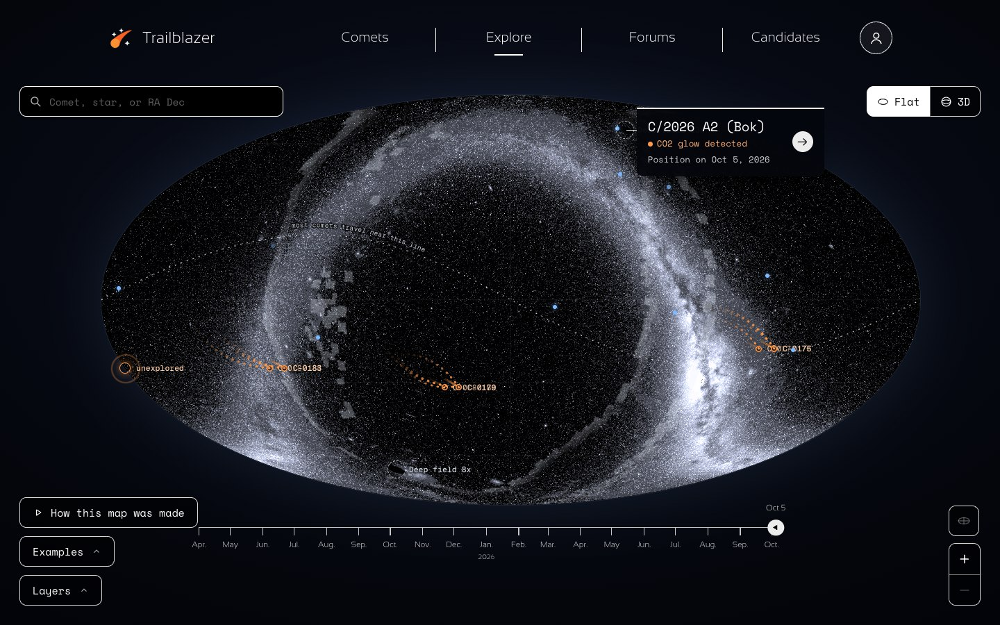

# Trailblazer



Trailblazer is a public web tool for NASA Space Apps 2026 (challenge: "Planet X and SPHEREx"). It lets anyone explore real infrared photos from NASA's SPHEREx telescope, find the dots that move between photos (comets, asteroids, nearby cold stars), read what SPHEREx measured in known comets, and talk about what they see. It was called Comet Catcher until 15 November 2026.

Live site: https://comet-hunt.comet-hunt.workers.dev

## What you can do

- **Explore the whole sky.** A map built from 272,962 SPHEREx photos, as a flat map or as a 3D sphere built from the real photo footprints. Drag the timeline to replay how the survey filled in the sky. Search by comet name, star name or RA/Dec. A 39-second film ("How this map was made") plays on a first visit and can be skipped.
- **Open a time-lapse of any spot.** Click the sky and the browser builds a time-lapse of that spot from SPHEREx's public archive: it finds the images, reads their pixels, lines them up and compares each star's motion with Gaia. No archive knowledge needed. Five pre-built targets (Barnard's Star, Epsilon Indi B, WISE 0855, RW Aurigae, R Draconis) always work.
- **See what is already known.** Known comets and asteroids that passed through each view are marked (IMCCE SkyBoT). 72 known comets are listed with the SPHEREx photos that caught them; ten have a measured spectrum, and three (3I/ATLAS, C/2025 R2 and C/2026 A2) show carbon dioxide gas at 4.26 micrometres.
- **Review candidates.** A cold-mover detector looks for slow, methane-absorbing objects that shift between survey passes. The Candidates page shows each find with its photos and its own checks (what it recovered, its false-alarm rate), and visitors can vote on what they think it is.
- **Discuss.** Comet pages have tags and comments (Cloudflare Turnstile keeps bots out), and Forums has a searchable feed of every thread. Seeded demo posts are labelled "example".

Honesty rule: anything that is sample or example data is labelled on screen. The credits are in the footer, and AI use is disclosed in `docs/AI_DISCLOSURE.md`.

## Run it

Needs Node 20 or newer.

```bash
npm install
cp worker/.dev.vars.example worker/.dev.vars
npm run dev
```

Then open http://localhost:8787. `worker/.dev.vars` holds Cloudflare's published test Turnstile secret so comment posting works locally (it is ignored by git; never commit a real secret). `npm run dev` applies the database migrations to a local D1 database and starts one Cloudflare Worker that serves both the site (`web/`) and the API (`/api/*`), the same way it runs once deployed. No Cloudflare account is needed locally.

## How it is built

- **Front end:** plain HTML, CSS and JavaScript in `web/`, no build step. three.js (loaded from a CDN) draws the 3D sky and the intro film. The time-lapse pipeline (`web/live/`) reads SPHEREx FITS images in the browser (including Rice decompression) in a Web Worker, so the free Worker tier only has to find the images.
- **Back end:** one Cloudflare Worker (`worker/src/`) plus a D1 database (`worker/migrations/`). It finds images with a prebuilt sky index, fetches Gaia stars and SkyBoT objects, serves comets, comments, candidates and the explored-sky counts, and caches answers in D1 so a slow archive does not slow the site. Details are in `docs/api.md`.
- **Data prep and science:** Python scripts in `bake/` build the coverage map, the sky index, the pre-built time-lapses, known-comet tracks and spectra, the 3D intro data, and the cold-mover detector with its own evaluations.

| Folder | What it holds |
|---|---|
| `web/` | The site. Pages: `index.html` (home), `explore.html` (map), `comet.html` (list and detail), `candidates.html`, `forums.html`, `timelapse.html`, `guide.html`. |
| `worker/` | The Worker, its tests, the D1 migrations and the sky-index reader. |
| `bake/` | Python data preparation and science checks. |
| `design/` | Screen designs, mockups, briefs and the demo video. |
| `docs/` | `team.md` (how we work), `api.md`, `architecture.html`, `PLAN-live.md`, `prior-art.md`, `AI_DISCLOSURE.md`. |

## Checks

- `npm test` runs the data and unit checks and the API contract (comment posting needs `worker/.dev.vars`, and it needs `npm run dev` running).
- `python3 bake/verify.py`: measured star motions against Gaia and published values.
- http://localhost:8787/tests/golden.html: the browser's astronomy maths against astropy.
- http://localhost:8787/tests/live.html: the live search against the pre-built targets.
- `web/tests/*.py`: browser tests (Playwright) for each page.

## Rebuilding data

Downloaded photo cutouts (`bake/cache/`) and the raw coverage list (`bake/coverage/`) are not in git. `bake/coverage.py` rebuilds the coverage list (about 90 minutes); `bake/sky_assets.py` turns it into `web/data/coverage.png`. The other `bake/` scripts say how to run them in their headers.

## Data credits

- SPHEREx images and sky tiles: NASA/IPAC Infrared Science Archive (IRSA).
- Star positions and motions: ESA Gaia DR3.
- Known comets and asteroids per image: IMCCE SkyBoT.
- Comet paths and predicted brightness: NASA JPL Horizons and the Small-Body Database.
- Galaxy redshifts for the depth data: SIMBAD, operated at CDS, Strasbourg, France (Harvard mirror). Star distances: ESA/Gaia/DPAC. Small-body distances: IMCCE SkyBoT (Berthier et al. 2006).
- Sky labels on the Explore map (`bake/sky_labels.py`, `web/data/labels.json`):
  - Constellation borders: Davenhall, A. C. & Leggett, S. K. 1989, *Catalogue of Constellation Boundary Data*, VizieR VI/49. Which constellation a position is in: Roman, N. G. 1987, PASP 99, 695, VizieR VI/42. This research has made use of the VizieR catalogue access tool, CDS, Strasbourg, France (DOI 10.26093/cds/vizier).
  - Constellation name positions and ranks: d3-celestial, © 2015 Olaf Frohn, BSD 3-Clause (full text in `web/data/labels-LICENSE.txt`).
  - Object positions: this research has made use of the SIMBAD database, operated at CDS, Strasbourg, France.
  - Star names: the IAU Working Group on Star Names (WGSN), from the IAU Catalog of Star Names (IAU-CSN, E. Mamajek).

## Deploying

Needs a Cloudflare account. Run `npx wrangler login` once, set the Turnstile secret with `npx wrangler secret put TURNSTILE_SECRET --config worker/wrangler.toml`, apply migrations with `npm run db:remote`, then `npm run deploy` from `main` after a merge.

## Team and licence

Built by a team of three at the NASA Space Apps Challenge, New York City (NYU Tandon). How we work and who owns what: `docs/team.md`. MIT licence (`LICENSE`).
